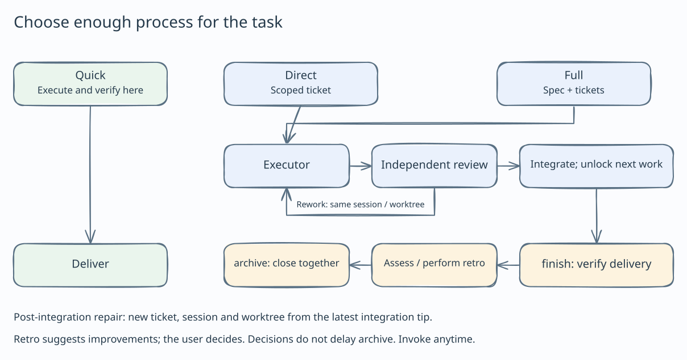

# paseo-matt-workloop

**English** · [简体中文](README.zh-CN.md)

A development workflow built on Matt Pocock skills and Paseo: from clarifying requirements to independent review and code integration, with an explicit scope, verification evidence, and delivery record for each task.

## 1. Skills and descriptions

The collection includes **17 skills**: 15 from [mattpocock/skills](https://github.com/mattpocock/skills), plus the local `paseo-workloop` and `codegraph` skills. Start with `paseo-workloop` to coordinate the workflow; the other skills supply methods and conventions for each stage and can also be used individually.

| Skill | Description |
| --- | --- |
| [paseo-workloop](skills/paseo-workloop/SKILL.md) | The workflow entry point. Coordinates Paseo executors and reviewers, task dependencies, isolated worktrees, review, rework, and serial integration. |
| [grill-me](skills/grill-me/SKILL.md) | Clarifies requirements, boundaries, and design choices through questions until the user and agent share an understanding. |
| [grill-with-docs](skills/grill-with-docs/SKILL.md) | Combines requirements questions with domain vocabulary and architectural decisions. In workloop, decisions are first recorded in the spec or ticket. |
| [grilling](skills/grilling/SKILL.md) | The underlying interview method: asks questions in rounds according to decision dependencies and resolves open choices progressively. |
| [domain-modeling](skills/domain-modeling/SKILL.md) | Establishes shared domain terminology and maintains glossaries and architecture decision records (ADRs). |
| [to-spec](skills/to-spec/SKILL.md) | Turns an existing discussion into an actionable spec covering the solution, implementation decisions, and testing approach. |
| [to-tickets](skills/to-tickets/SKILL.md) | Splits a spec into verifiable vertical slices and declares blocking dependencies between tickets. |
| [implement](skills/implement/SKILL.md) | Implements a spec or ticket while following project conventions and verifying the result. |
| [tdd](skills/tdd/SKILL.md) | Guides red → green → refactor development, prioritizing tests of observable behavior. |
| [code-review](skills/code-review/SKILL.md) | Reviews changes against a fixed commit or branch baseline, checking repository standards and the originating requirements separately. |
| [diagnosing-bugs](skills/diagnosing-bugs/SKILL.md) | Investigates difficult bugs and performance regressions through reproduction, measurement, and evidence. |
| [codegraph](skills/codegraph/SKILL.md) | Navigates symbols, call paths, and change impact in repositories that already have a CodeGraph index. |
| [codebase-design](skills/codebase-design/SKILL.md) | Examines module boundaries and interfaces to simplify APIs, encapsulate complexity, and improve testability. |
| [improve-codebase-architecture](skills/improve-codebase-architecture/SKILL.md) | Finds architecture improvement opportunities, presents an HTML report, and explores the selected direction. |
| [handoff](skills/handoff/SKILL.md) | Captures the current conversation's goal, decisions, evidence, and unfinished work for another agent. |
| [wait-what](skills/wait-what/SKILL.md) | Pauses and explains the previous message again when it did not communicate the point clearly. |
| [setup-matt-pocock-skills](skills/setup-matt-pocock-skills/SKILL.md) | Configures issue tracking, labels, and domain documentation when using the upstream engineering skills independently. Workloop uses its own run directory and does not require this setup. |

Upstream skills remain unchanged. Workloop-specific behavior lives in the local skill and executor/reviewer briefs. Source versions are recorded in [upstream.json](skills/tools/upstream.json).

## 2. Workflow diagram and explanation



1. **Clarify and agree on requirements.** The orchestrator and user establish the goal, scope, and acceptance checks, then choose the Direct or Full route together.
2. **Prepare and approve tasks.** Direct handles a bounded change with one ticket containing a `Scope` and acceptance commands. Full starts with a spec and splits it into tickets with dependencies. The run starts after user approval.
3. **Execute in isolation.** Executors implement, self-check, and commit in separate worktrees. Full can run multiple executors within dependency and concurrency limits. The orchestrator receives completion notifications and coordinates questions.
4. **Freeze the candidate and review independently.** A reviewer checks a fixed commit against requirements, standards, and verification evidence. Required changes return to the executor, and the new candidate is reviewed again. An executor reporting completion does not mean the ticket has passed acceptance.
5. **Integrate serially and verify.** Reviewed candidates merge into the local integration branch one at a time, followed by the configured checks. Conflicts or failed checks lead to a fix, another review, and another integration attempt. Failed checks roll back that merge.
6. **Review the whole result and deliver.** For Full, the orchestrator checks cross-ticket behavior, documentation, and overall regression results. Defects become repair tickets that follow the same execution and review loop. Direct skips this final review. Finally, `finish` reruns checks and cleans up resources while retaining the local `workloop/<feature>` branch. The user decides whether to publish it.

See [paseo-workloop](skills/paseo-workloop/SKILL.md) for the full procedure and [recovery notes](skills/paseo-workloop/reference/recovery.md) for interrupted runs.

## 3. Installation

Installation requires **Node.js 20+, npm, and Git** on macOS, Linux, or Windows. Run the installer directly from GitHub without manually cloning, installing an npm package globally, or signing in to npm. Keep the `github:suntianc/` prefix in each command.

Choose one of two categories based on where your agent reads skills:

| Agent category | Installation directory | When to use it |
| --- | --- | --- |
| **Claude-compatible agents** | `~/.claude/skills` | Claude Code and compatible agents that read Claude's skills directory. |
| **General agents** | `~/.agents/skills` (default) | Agents that read the shared Agent Skills directory. If your agent uses another directory, provide its actual path with `--target`. |

Install on the **machine where the Paseo daemon, executors, and reviewers run**. For a remote host, install on that host. If agents use different skills directories, install and update each directory separately. The installer does not change global agent configuration.

### Claude-compatible agents

**macOS / Linux (sh, bash, zsh):**

```sh
# Install
npx --yes github:suntianc/paseo-matt-workloop#main install --target "$HOME/.claude/skills"

# Update
npx --yes github:suntianc/paseo-matt-workloop#main update --target "$HOME/.claude/skills"
```

**Windows (PowerShell):**

```powershell
# Install
npx --yes github:suntianc/paseo-matt-workloop#main install --target "$HOME/.claude/skills"

# Update
npx --yes github:suntianc/paseo-matt-workloop#main update --target "$HOME/.claude/skills"
```

### General agents

**macOS / Linux (sh, bash, zsh):**

```sh
# Install into the default ~/.agents/skills
npx --yes github:suntianc/paseo-matt-workloop#main install

# Update
npx --yes github:suntianc/paseo-matt-workloop#main update
```

**Windows (PowerShell):**

```powershell
# Install into the default $HOME/.agents/skills
npx --yes github:suntianc/paseo-matt-workloop#main install

# Update
npx --yes github:suntianc/paseo-matt-workloop#main update
```

If your agent does not read the default directory, append `--target "actual skills directory"` to both commands. Install the whole collection: its skills, scripts, and templates rely on the sibling directory layout.

### Updates and conflicts

Installed files are independent of the npx cache. `update` fetches the current public `main` branch each time and prints the source commit. Restart your agent or refresh its skills after installation or an update.

The target's `.paseo-matt-workloop.json` records the managed content. Existing same-name skills, local modifications within managed entries, added or missing files, and symbolic links cause the operation to stop. Back up local customizations before restoring the managed content or choosing an empty directory. Unrelated skills remain in place.

Preview checks or inspect available skills and options with these commands. Include `--target` as usual for a custom directory:

```sh
npx --yes github:suntianc/paseo-matt-workloop#main install --dry-run
npx --yes github:suntianc/paseo-matt-workloop#main update --dry-run
npx --yes github:suntianc/paseo-matt-workloop#main list
npx --yes github:suntianc/paseo-matt-workloop#main --help
```

A failed update attempts to roll back. After a forced termination or power loss, previous files may remain under `.paseo-matt-workloop-stage-*/old/`. Restore them as needed, and remove `.paseo-matt-workloop.lock` only after confirming that no installer is running.

## 4. Runtime requirements and usage

### Runtime requirements

Installing skills and running workloop are separate steps. Orchestration also requires:

- **Paseo environment:** Git, the Paseo CLI, and a running daemon. Run inside a Paseo agent session with `PASEO_AGENT_ID` set.
- **Orchestration tools:** Agent-scoped `create_agent`, `send_agent_prompt`, and heartbeat support in the current session for dispatch, messaging, completion notifications, and fallback wake-ups.
- **Role settings:** Create `wl-executor` and `wl-reviewer` profiles in Paseo with a provider, model, and mode, or explicitly select alternatives. The user chooses models and permission modes; the skill installer does not create or change these profiles.
- **Project baseline:** A Git repository whose configured checks already pass on the base. `codegraph` is used only when the project already has an index; CodeGraph is not a requirement for every project.

Check the basic environment first:

```sh
node --version
git --version
paseo --version
paseo agent ls -g --json
paseo provider ls --json
```

See the [compatibility notes](skills/paseo-workloop/reference/paseo-compat.md) for version-specific behavior and verification limits. Other skills can be used individually without the orchestration tools; the complete workloop requires the conditions above.

### Start a development task

Open your project in Paseo and start an agent that has loaded this collection. Name the skill, goal, and acceptance expectations in natural language, for example:

```text
Use paseo-workloop to add CSV export to this project.
First agree with me on requirements, scope, and acceptance checks,
then choose the Direct or Full route.
```

The agent follows the workflow in section 2, prepares the tasks, and asks for your approval. During a run, the orchestrator communicates with executors and reviewers; scope changes, product decisions, and role configuration questions come back to the user.

To inspect an existing run, ask the orchestrator for its status or run:

```sh
# Default general-agent location; use ~/.claude/skills for Claude-compatible agents
node ~/.agents/skills/paseo-workloop/scripts/workloop.mjs --run my-project/export-csv status --live
```

Replace the example `my-project/export-csv` with your actual run name. In Windows PowerShell, use `"$HOME/.agents/skills/paseo-workloop/scripts/workloop.mjs"` for the script path.

### State, delivery, and tidy-docs

Run state defaults to `~/.workloop/<project>/<feature>/` and can be relocated with `WORKLOOP_ROOT`. Specs, tickets, briefs, reports, and reviews stay in the run directory. Do not edit `state.json` manually. Skill updates do not migrate run state; finish runs using older scripts before updating when possible.

`finish` retains the local `workloop/<feature>` branch. It does not merge it into the main branch or push it. Publishing and PRs require separate user authorization. See [async supervision](skills/paseo-workloop/reference/async-supervision.md) for notification handling and recovery.

To use `/tidy-docs` in a project, register it once on each machine:

```sh
# General agents; for Claude-compatible agents, use the same path under ~/.claude/skills
node ~/.agents/skills/paseo-workloop/scripts/tidy-docs.mjs install --repo /path/to/repo
```

In Windows PowerShell, use `"$HOME/.agents/skills/paseo-workloop/scripts/tidy-docs.mjs"` and replace `--repo` with the actual project path. Registration files contain machine-specific paths and are excluded from the project's Git commits. See the [tidy-docs procedure](skills/paseo-workloop/reference/tidy-docs.md).

### Maintaining the collection

This repository distributes skills and installation tools. Maintainers can run the following checks; upstream synchronization is documented in the [collection maintenance guide](skills/README.md#updating-from-upstream):

```sh
npm test
npm run check:links
npm pack --dry-run
```

## 5. Acknowledgments

Thank you to **[Matt Pocock](https://github.com/mattpocock)** and **[Paseo](https://github.com/getpaseo)**:

- **[mattpocock/skills](https://github.com/mattpocock/skills)** supplies the 15 upstream skills used here, covering requirements interviews, domain modeling, specs, ticket breakdown, implementation, testing, and review.
- **[getpaseo/paseo](https://github.com/getpaseo/paseo)** provides the multi-agent runtime and orchestration foundation that lets workloop coordinate independent executors, reviewers, and worktrees.

Local code is licensed under the [MIT License](LICENSE). Matt Pocock's original MIT notice is preserved in [THIRD_PARTY_LICENSES](THIRD_PARTY_LICENSES). Source versions and local additions are documented in [NOTICE.md](NOTICE.md).
