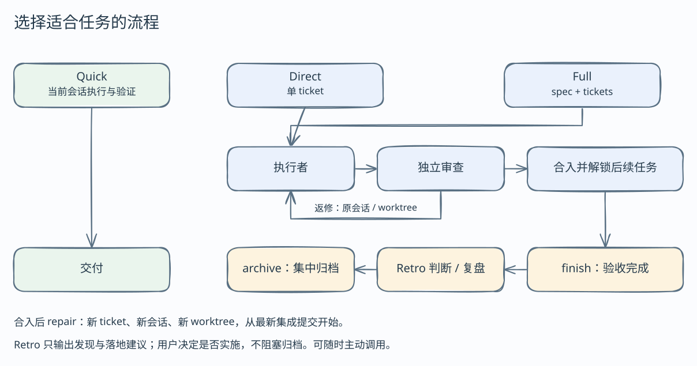

# paseo-matt-workloop

[English](README.md) · **简体中文**

将开发需求推进为本地集成分支上经过审查的代码。Matt Pocock skills 提供工作方法，Paseo 运行执行者和审查者。

## 1. 技能清单

以 **`paseo-workloop`** 为编排入口，也可单独使用配套技能。整套包含 15 个上游技能，以及 `paseo-workloop`、`codegraph` 两个本地技能。

| 技能 | 用途 |
| --- | --- |
| [paseo-workloop](skills/paseo-workloop/SKILL.md) | 通过 Paseo 协调任务、独立 worktree、独立审查、返工与串行集成。 |
| [grill-me](skills/grill-me/SKILL.md) | 与用户澄清需求目标、边界和设计选择。 |
| [grill-with-docs](skills/grill-with-docs/SKILL.md) | 在澄清需求时记录领域术语和架构决策。 |
| [grilling](skills/grilling/SKILL.md) | 按决策依赖分轮追问，在前提明确后提出后续问题。 |
| [domain-modeling](skills/domain-modeling/SKILL.md) | 统一领域术语，通过词汇表和 ADR 记录共识与决策。 |
| [to-spec](skills/to-spec/SKILL.md) | 将已达成共识的讨论整理为包含实现和测试决策的规格。 |
| [to-tickets](skills/to-tickets/SKILL.md) | 将规格拆成纵向任务，明确阻塞依赖。 |
| [implement](skills/implement/SKILL.md) | 按项目约定实现并验证规格或任务。 |
| [tdd](skills/tdd/SKILL.md) | 通过 red → green → refactor 开发，测试可观察行为。 |
| [code-review](skills/code-review/SKILL.md) | 从固定基线审查变更，核对项目规范和原始需求。 |
| [diagnosing-bugs](skills/diagnosing-bugs/SKILL.md) | 先复现、测量故障或性能回退，再选择修复方案。 |
| [codegraph](skills/codegraph/SKILL.md) | 在已有索引的仓库中导航符号、调用链和变更影响范围。 |
| [codebase-design](skills/codebase-design/SKILL.md) | 设计模块边界，用简洁接口封装复杂性。 |
| [improve-codebase-architecture](skills/improve-codebase-architecture/SKILL.md) | 寻找架构改进机会，通过 HTML 报告选择并讨论方案。 |
| [handoff](skills/handoff/SKILL.md) | 整理包含目标、决定、证据和未完成工作的交接文档。 |
| [wait-what](skills/wait-what/SKILL.md) | 请 Agent 重新解释上一条消息。 |
| [setup-matt-pocock-skills](skills/setup-matt-pocock-skills/SKILL.md) | 为单独使用上游工程技能配置任务跟踪和领域文档。 |

## 2. 工作流程



澄清需求后，与用户共同选择路线：

| 路线 | 适用条件 | 待用户确认的材料 |
| --- | --- | --- |
| **Direct** | 目标、范围和验收检查明确，改动不涉及公共行为或共享接口。 | 一张带 `Scope` 的 ticket，每项验收标准都有对应验证命令。 |
| **Full** | 需要设计决策、更大范围，或可并行执行的多个任务。 | spec、带依赖关系的 tickets，以及测试方案。 |

两条路线都经过以下关口：

| 阶段 | 完成条件 |
| --- | --- |
| **确认** | 用户已确认范围、任务和验收检查。 |
| **执行** | 执行者已提交任务改动，worktree 干净，并提供包含验收检查结果的本轮 `done` 报告。 |
| **审查** | 冻结的候选 commit 已通过基于任务和验证证据的独立审查。需要返工时，提交新的候选再次审查。 |
| **集成** | 通过审查的候选已合入本地集成分支，约定检查全部通过。冲突交回执行者处理；检查失败则回滚本次合入。 |
| **收尾** | 所有任务均已关闭，`finish` 检查通过并完成清理。Full 还要求编排者对当前集成提交完成文档与整体复核；缺陷通过 repair ticket 修复。 |

交付物是本地 `workloop/<feature>` 分支。是否发布、创建 PR 或合入主分支，由用户决定。

## 3. 安装

在 Paseo 运行 Agent 的机器上准备 **Node.js 20+、npm 和 Git**。连接远程 Paseo host 时，在该 host 安装。

按 Agent 读取技能的位置选择目录。以下命令适用于 macOS/Linux shell 和 Windows PowerShell。

### Claude 类

适用于 Claude Code，以及读取 `~/.claude/skills` 的兼容 Agent：

```sh
# 安装
npx --yes github:suntianc/paseo-matt-workloop#main install --target "$HOME/.claude/skills"

# 更新同一目录
npx --yes github:suntianc/paseo-matt-workloop#main update --target "$HOME/.claude/skills"
```

### 通用 Agent 类

适用于读取默认目录 `~/.agents/skills` 的 Agent：

```sh
# 安装
npx --yes github:suntianc/paseo-matt-workloop#main install

# 更新
npx --yes github:suntianc/paseo-matt-workloop#main update
```

使用其他技能目录时，在两个命令后都加上 `--target "实际技能目录"`。保持整套技能相邻存放，workloop 通过相对路径读取配套技能和资源。

命令成功后，重启或刷新 Agent 的技能列表；能发现 `paseo-workloop` 即完成安装。安装文件独立于 npx 缓存；`update` 每次拉取 GitHub 最新 `main` 并打印来源 commit。

**安装或更新提示冲突时**，先备份所列的本地内容，再恢复托管副本或换一个空目录安装。安装器通过 `.paseo-matt-workloop.json` 记录归属，保留其他技能。添加 `--dry-run` 可在写入前检查目标目录；其他参数见 `--help`。

## 4. 运行条件与使用说明

### 准备运行环境

启动 run 前，确认以下条件：

| 条件 | 就绪标准 |
| --- | --- |
| **Paseo daemon** | `paseo agent ls -g --json` 能从预期 host 返回 JSON。 |
| **Agent 会话** | 编排者位于 Paseo 会话中，具有 `PASEO_AGENT_ID`、agent-scoped `create_agent` 和 `send_agent_prompt` 工具，以及 heartbeat 支持。 |
| **角色配置** | `wl-executor`、`wl-reviewer` 或显式指定的替代配置，能解析为用户选择的 provider、model 和 mode；在 Paseo 中配置。 |
| **项目基线** | 目标是 Git 仓库，本次 run 选定的检查在基线上已经通过。 |

遇到版本差异或前置条件不满足时，先查阅 [Paseo 兼容说明](skills/paseo-workloop/reference/paseo-compat.md)，再启动 worker。其他技能可以独立于这套编排环境使用；`codegraph` 适用于项目已有索引的情况。

### 开始一次 run

在 Paseo 中打开项目，使用已加载这套技能的 Agent，说明目标和验收要求：

```text
请使用 paseo-workloop，为这个项目增加 CSV 导出。
启动 run 前，先和我确认范围及验收检查。
```

**编排 run 时**，读取并遵循 [paseo-workloop](skills/paseo-workloop/SKILL.md)。其中定义了命令、确认关口、角色 briefs 和集成步骤。Workloop 在运行目录中维护自己的任务跟踪，可直接使用配套技能启动。

规格、任务、briefs、报告和状态默认保存在 `~/.workloop/<project>/<feature>/`，可通过 `WORKLOOP_ROOT` 调整根目录。更新脚本前，先结束使用旧脚本的活动 run。

按当前情况查阅对应说明：

- **worker 仍在运行、编排者即将暂停时：** 按 [异步监督](skills/paseo-workloop/reference/async-supervision.md) 配置通知和兜底 heartbeat。
- **会话或操作中断后：** 按 [恢复说明](skills/paseo-workloop/reference/recovery.md) 核对当前状态，再执行下一步。
- **需要整理项目文档时：** 按 [tidy-docs](skills/paseo-workloop/reference/tidy-docs.md) 完成本机注册和文档工作流。
- **维护或同步这套技能时：** 按 [技能集指南](skills/README.md) 操作；检查命令以 [package.json](package.json) 为准。

## 5. 致谢

- **[Matt Pocock / skills](https://github.com/mattpocock/skills)**：为这套工作流提供上游工程与效率技能。上游内容保持原样，workloop 的适配集中在本地技能和角色 briefs 中。
- **[Paseo](https://github.com/getpaseo/paseo)**：提供独立编程 Agent、工作区与完成通知的编排基础。

本地代码采用 [MIT License](LICENSE)。上游声明保留在 [THIRD_PARTY_LICENSES](THIRD_PARTY_LICENSES)，来源版本与流程图归属记录见 [NOTICE.md](NOTICE.md)。
